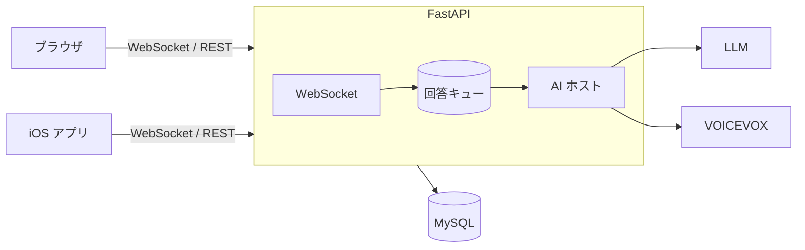

# AIライブショップ

日本語 | [中文](docs/README.zh-CN.md)

AI ホスト「花奈」がライブ配信のコメントに音声と表情で答え、そのまま購入まで完結する、日本向けライブコマースの Web アプリと iOS アプリ。

**公開URL:** https://live.masteren.cloud

<p>
  
  
  
</p>

## 機能
- **AI ホスト**:コメントに LLM(OpenAI / Claude)で回答。価格・在庫は DB と照合し、合わなければルール応答に切り替える
- **音声・3D アバター**:VOICEVOX の音声に合わせて、three-vrm のアバターが口パク・表情・まばたき
- **ライブ配信**:WebSocket でコメントを即時配信、視聴者数、自動再接続
- **EC**:商品 → カート → 決済(モック)→ 注文。購入はライブで告知される
- **管理画面**:商品・在庫の管理、売上統計
- **iOS アプリ**:SwiftUI で同じ API を利用

## 技術
| | |
|---|---|
| バックエンド | Python 3.12 / FastAPI / SQLAlchemy 2.0(async)/ Alembic |
| DB | MySQL 8.4(テストは SQLite。CI で両方実行) |
| フロント | HTML / CSS / JavaScript、three.js + three-vrm |
| iOS | SwiftUI / URLSession / Keychain |
| インフラ | Docker Compose、Nginx、Let's Encrypt |
| テスト | pytest 123件、E2E 41件、XCUITest、GitHub Actions |


設計資料:[要件定義](docs/design/requirements.md) / [ER 図](docs/design/er.md) / [シーケンス図](docs/design/sequence.md) / [画面遷移図](docs/design/screens.md)

## 工夫した点
1. **同時注文での売り越し防止**:在庫の減算を条件付き UPDATE で行う。並行テストで、SQLite では行ロックが効かず5人全員が購入できてしまうことを見つけて直した
2. **認証**:Web は HttpOnly Cookie + CSRF トークン、iOS は Bearer トークン。パスワードは PBKDF2(60万回)
3. **LLM の出力を信用しない**:返答中の金額・割引率・在庫を DB と照合する(実際に割引率を間違えたため)
4. **外部サービスが落ちても配信を止めない**:LLM がなければルール応答、VOICEVOX が止まれば文字だけにする

## 起動
```bash
python3.12 -m venv venv && source venv/bin/activate
pip install -r requirements.txt
cp .env.example .env
docker compose up -d db
uvicorn app.main:app --reload
```
http://127.0.0.1:8000 (管理画面は `/admin`)。LLM のキーがなくても動く。

テスト:`pip install -r requirements-dev.txt && pytest`

## 素材
- 3D モデル:[DeepSeek蓝色大肥鱼](https://www.aplaybox.com/details/model/PIuLwHuG6mKr)(作者 [喜欢看雨OvO](https://space.bilibili.com/135840826))。作者の許可を得て、非商用に限り同梱している(`app/static/models/custom/README.md`)。ない場合は pixiv の [VRM サンプルモデル](https://vrm.dev/licenses/1.0/)で表示する
- 音声:[VOICEVOX](https://voicevox.hiroshiba.jp/)(ずんだもん)
